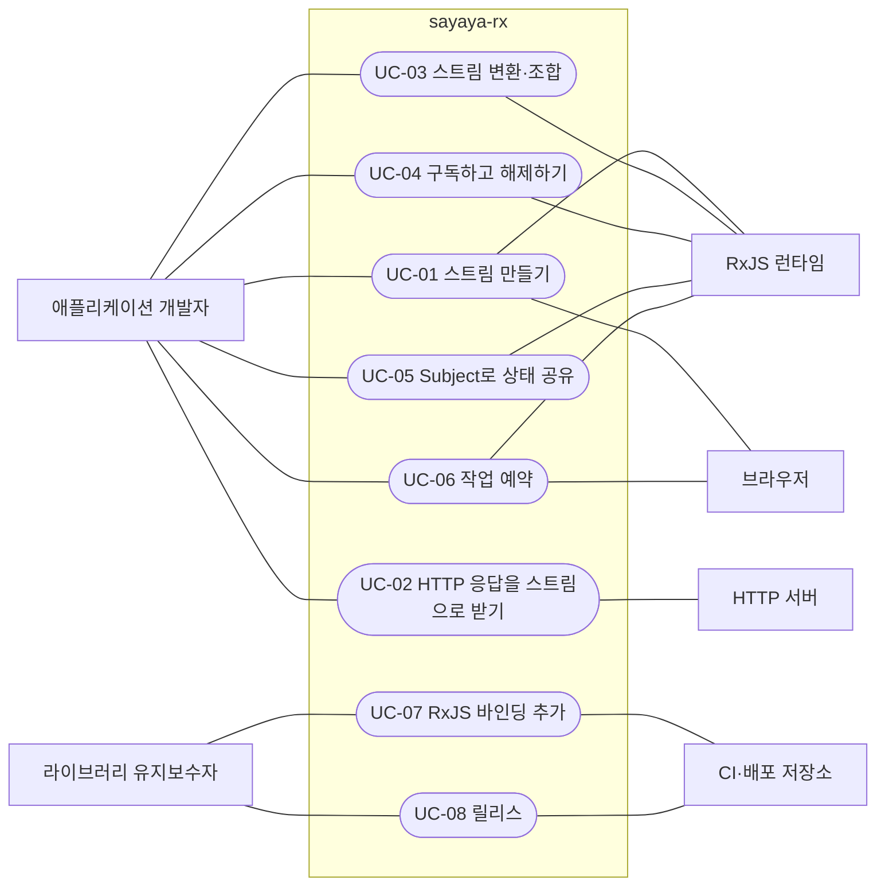

# 유스케이스 모델

## 액터

| 액터 | 종류 | 설명 |
|---|---|---|
| 애플리케이션 개발자 | 주 액터 | GWT 애플리케이션 코드에서 이 라이브러리를 호출하는 사람(그가 작성한 코드) |
| 라이브러리 유지보수자 | 주 액터 | 바인딩을 추가·수정하고 릴리스하는 사람 |
| RxJS 런타임 | 보조 액터(외부 시스템) | 브라우저 전역 `rxjs` 객체. 실제 스트림 처리를 수행 |
| 브라우저 | 보조 액터(외부 시스템) | DOM 이벤트, 타이머, `fetch`/XHR 제공 |
| HTTP 서버 | 보조 액터(외부 시스템) | `fromRequest`/`fetchJson` 요청의 상대 |
| CI(GitHub Actions)·배포 저장소 | 보조 액터(외부 시스템) | 테스트·배포 워크플로 실행, Maven Central·GitHub Packages |

## 유스케이스 다이어그램

Mermaid에는 유스케이스 표기가 없어 `flowchart`로 근사했습니다(둥근 노드 = 유스케이스, 사각 노드 = 액터).

## 유스케이스 요약 (brief)

| ID | 이름 | 요약 | 요구사항 |
|---|---|---|---|
| UC-01 | 스트림 만들기 | 개발자가 값, 범위, 컬렉션, Promise, 시간, DOM 이벤트로부터 Observable을 만든다 | FR-01, FR-02, FR-03 |
| UC-02 | HTTP 응답을 스트림으로 받기 | 개발자가 요청(URL, 메서드, 헤더, 본문)을 기술하고 응답(상태, 헤더, 본문)을 스트림으로 받는다 | FR-04 |
| UC-03 | 스트림 변환·조합 | 개발자가 연산자를 체인으로 이어 값을 변환·필터·결합·버퍼링·속도 제한한다 | FR-05, FR-06 |
| UC-04 | 구독하고 해제하기 | 개발자가 값·에러·완료를 받을 콜백으로 구독하고, 필요하면 해제한다 | FR-07, FR-08 |
| UC-05 | Subject로 상태 공유 | 개발자가 Subject를 만들어 여러 구독자에게 값을 멀티캐스트하거나 최근 값을 공유한다 | FR-09 |
| UC-06 | 작업 예약 | 개발자가 스케줄러로 작업을 지연 실행하거나 상태를 바꿔 재귀 예약한다 | FR-10 |
| UC-07 | RxJS 바인딩 추가 | 유지보수자가 RxJS 연산자·생성 함수의 바인딩과 검증 테스트를 추가한다 | MR-01 |
| UC-08 | 릴리스 | 유지보수자가 버전 태그로 배포를 시작하고 공개를 확인한다 | MR-02 |

## 상세 유스케이스 (fully dressed)

위험이 큰(JsInterop 경계를 넘는) 두 유스케이스를 자세히 씁니다. UC-07·UC-08의 상세 절차는 [구현 가이드](../03-construction/implementation-guide.md)와 [릴리스 절차](../04-transition/release.md)에 있습니다.

### UC-04 구독하고 해제하기

- **주 액터:** 애플리케이션 개발자
- **이해관계자와 관심사:** 개발자는 값을 순서대로 받고, 에러를 놓치지 않기를 원한다.
- **사전 조건:** 페이지에 RxJS UMD가 GWT 모듈보다 먼저 로드되었다. 개발자가 Observable을 가지고 있다(UC-01, UC-03).
- **성공 보장:** 구독 핸들(Subscription)을 얻고, 스트림이 끝날 때까지 값과 종료 신호(완료 또는 에러) 중 하나를 받는다.

**주 성공 시나리오**
1. 개발자가 값·에러·완료 처리 방법을 지정해 구독을 요청한다.
2. 시스템이 구독을 시작하고 구독 핸들을 돌려준다.
3. 시스템이 방출되는 각 값을 개발자에게 전달한다. (반복)
4. 시스템이 완료를 알린다.

**확장(대안·예외 흐름)**
- 3a. 스트림에서 에러가 발생한다.
  1. 개발자가 에러 처리 방법을 지정했으면 시스템이 그 처리 방법으로 에러를 전달하고 시나리오가 끝난다.
  2. 값 처리 방법만 지정했으면(람다 구독), 시스템이 에러를 처리되지 않은 에러로 보고한다: `rxjs.config.onUnhandledError`가 있으면 그것을 호출하고, 없으면 비동기로 throw한다. 에러는 조용히 사라지지 않는다.
- 3b. 개발자가 스트림 종료 전에 구독 해제를 요청한다.
  1. 시스템이 값 전달을 멈추고 자원(타이머, 이벤트 리스너, 요청)을 정리한다. 완료는 알리지 않는다.
- 2a. RxJS가 로드되지 않았다.
  1. 첫 호출에서 JS 런타임 에러가 난다. (이 라이브러리는 이 상황을 복구하지 않는다. 사전 조건 위반.)

### UC-02 HTTP 응답을 스트림으로 받기

- **주 액터:** 애플리케이션 개발자 / **보조 액터:** HTTP 서버
- **사전 조건:** UC-04와 같음. RxJS UMD 번들에 `rxjs.ajax`가 포함되어 있다.
- **성공 보장:** 응답 상태, 응답 헤더, 본문(JSON은 객체로)을 한 번 받고 완료된다.

**주 성공 시나리오**
1. 개발자가 요청(URL, 메서드, 헤더, 본문, 타임아웃)을 기술한다.
2. 개발자가 그 요청으로 응답 스트림을 요청한다.
3. 개발자가 구독한다(UC-04).
4. 시스템이 HTTP 서버에 요청을 보낸다.
5. 시스템이 응답(상태, 헤더, 본문)을 한 번 전달하고 완료한다.

**확장**
- 1a. 개발자가 본문 JSON만 필요하다: URL만으로 JSON 본문 스트림을 요청한다(`fetchJson`).
- 5a. 네트워크 실패, 타임아웃 또는 HTTP 에러 상태: 시스템이 에러를 전달한다(UC-04 3a). 개발자는 `catchError`/`retry`로 대체 값이나 재시도를 지정할 수 있다(UC-03).
