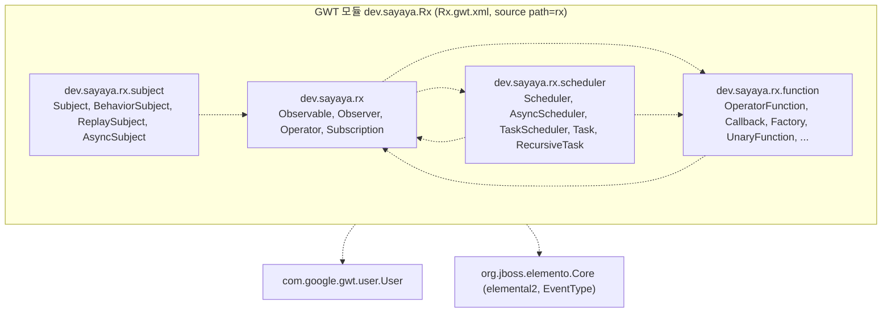
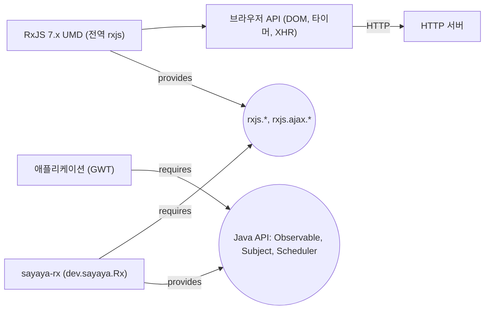
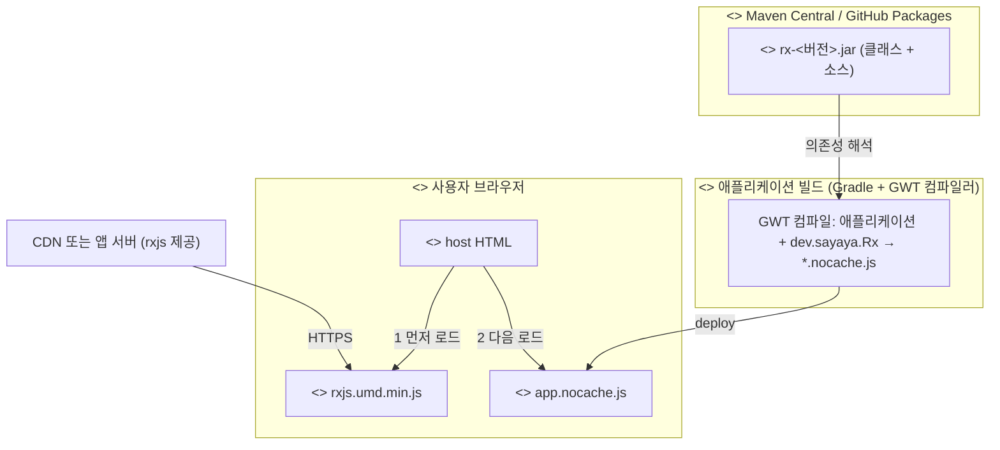

# 아키텍처

## 아키텍처 결정 요약

| ID | 결정 | 이유(품질 속성) | 대가 |
|---|---|---|---|
| AD-01 | RxJS를 번들하지 않고 전역 `rxjs`를 네이티브 타입으로 가리킨다 | 상호운용성, 성능: 재구현·래퍼 없음 (NFR-01, NFR-02) | 사용 HTML이 RxJS UMD를 먼저 로드해야 함. 로드 순서가 틀리면 첫 호출에서 JS 에러 |
| AD-02 | Java다운 API는 `@JsOverlay`로 얹는다 | 사용성, 성능 (NFR-02) | 오버레이는 상속·다형성이 없음(`final`이거나 `static`) |
| AD-03 | JS 경계 값을 Java 타입으로 변환해 노출한다(`JsNumber`→`Integer`, JS 배열→`List`) | 타입 안전성 (NFR-03) | 변환 `map` 단계가 하나 더 생김 |
| AD-04 | 가변인자를 JS 배열로 넘겨야 하는 곳은 `Object`로 감싼다(`from(List)` → `from((Object) list.toArray())`) | 정확성: GWT는 Java 가변인자를 JS 인자 여러 개로 펼친다 | 시그니처마다 확인 필요 |
| AD-05 | 람다 구독은 JS 함수를 그대로 넘긴다(`subscribeNext`) | 신뢰성: 에러가 사라지지 않음 (FR-08) | 네이티브 오버로드가 하나 늘어남 |
| AD-06 | 라이브러리 jar에 소스를 포함한다(`jar { from(sourceSets.main.get().allSource) }`) | GWT 컴파일러가 Java 소스를 필요로 함 | jar 크기 증가 |
| AD-07 | 패키지 순환 의존(`rx`↔`scheduler`, `rx`↔`function`)을 수용한다(2026-11 결정) | 호환성: 해소하려면 공개 타입(`Subscription`, `AsyncScheduler`, `OperatorFunction`)의 패키지를 옮겨야 해서 사용자 import가 깨짐. RxJS 자체의 상호 참조를 반영한 것이고 하나의 GWT 모듈로 컴파일되어 빌드·성능 피해가 없음 | 패키지를 별도 GWT 모듈로 쪼갤 수 없음. 메이저 버전에서 모듈 분리가 필요해지면 재검토 |

## 패키지 다이어그램

Mermaid에 패키지 다이어그램이 없어 `flowchart`의 `subgraph`와 점선 화살표(의존)로 근사했습니다.



순환 의존이 두 개 있습니다.
- `rx`→`scheduler`(`Observable.throttleTime`이 `Scheduler.async()` 사용)와 `scheduler`→`rx`(`AsyncScheduler`·`TaskScheduler`가 `Subscription` 반환)
- `rx`→`function`과 `function`→`rx`(`OperatorFunction`이 `Observable`을 다룸)

모두 RxJS 자체의 상호 참조를 그대로 반영한 것이고 하나의 GWT 모듈로 컴파일되므로 빌드 문제는 없습니다. 패키지를 별도 모듈로 쪼갤 때는 먼저 풀어야 합니다.

호환성을 깨지 않고 풀 수 있는지 검토했지만 방법이 없었습니다. 순환을 만드는 것은 내부 구현이 아니라 공개 시그니처입니다: `Observable.throttleTime(int, AsyncScheduler<T>)`, `AsyncScheduler.schedule(...)`/`TaskScheduler.schedule(...)`의 반환 타입 `Subscription`, `OperatorFunction.call(Observable<T>)`와 `Observable.pipe(OperatorFunction)`. 그래서 순환을 **AD-07로 수용**하고, 메이저 버전에서 모듈 분리가 필요할 때 다시 검토합니다.

## 컴포넌트 다이어그램

`flowchart`로 근사했습니다. 동그라미는 인터페이스, 실선은 프로세스 안의 JS 호출입니다(네트워크 경계는 HTTP 서버뿐).



## 배포 다이어그램

개발 시점과 실행 시점을 구분합니다. Mermaid로 근사했습니다.



호스트 HTML은 반드시 RxJS UMD를 먼저, GWT `nocache.js`를 나중에 로드해야 합니다. 테스트 HTML이 이 순서의 기준 예시입니다(`src/test/webapp/operator.html`).

```html
<script src="https://unpkg.com/rxjs@7.8.2/dist/bundles/rxjs.umd.min.js"></script>
<script src="operator/operator.nocache.js"></script>
```

## 빌드 구성

| 항목 | 값 | 위치 |
|---|---|---|
| GWT | 2.13.1, `sourceLevel = "auto"`, `strict = true`, `draftCompile = true`, `generateJsInteropExports = true` | `build.gradle.kts` `tasks.gwt` |
| GWT 플러그인 | `dev.sayaya.gwt` 2.4.0 | `build.gradle.kts` `plugins` |
| Kotlin(테스트용) | 2.4.21, `jvmToolchain(21)` | `build.gradle.kts` |
| 의존성 | `elemento-core` 2.5.14, 테스트 `gwt-test` 2.4.0 | `build.gradle.kts` `dependencies` |
| Gradle | wrapper 9.9.1 (로컬). CI는 러너의 `gradle` 사용 | `gradle/wrapper` (git 미추적) |
