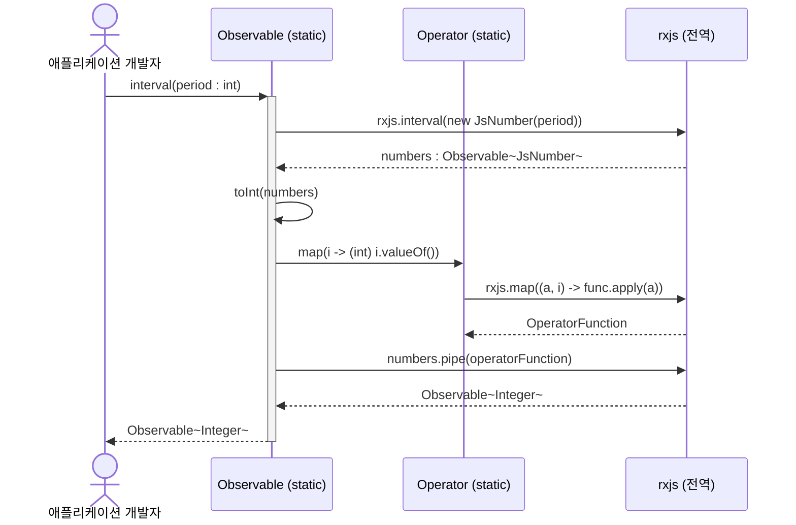
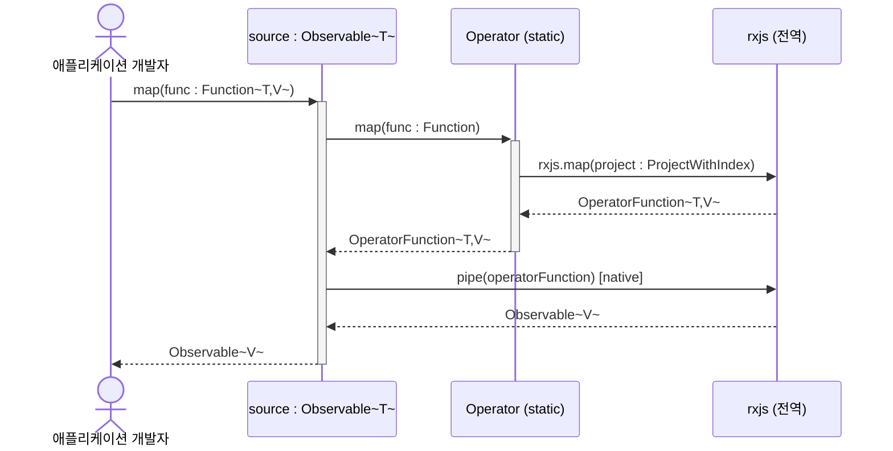
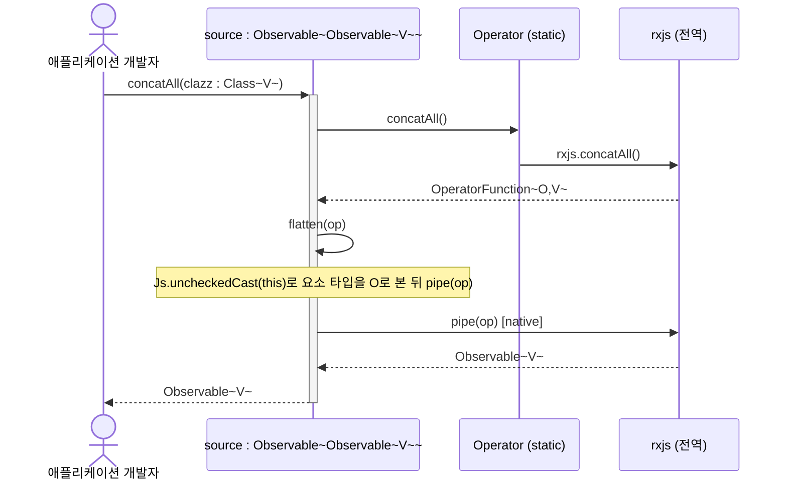
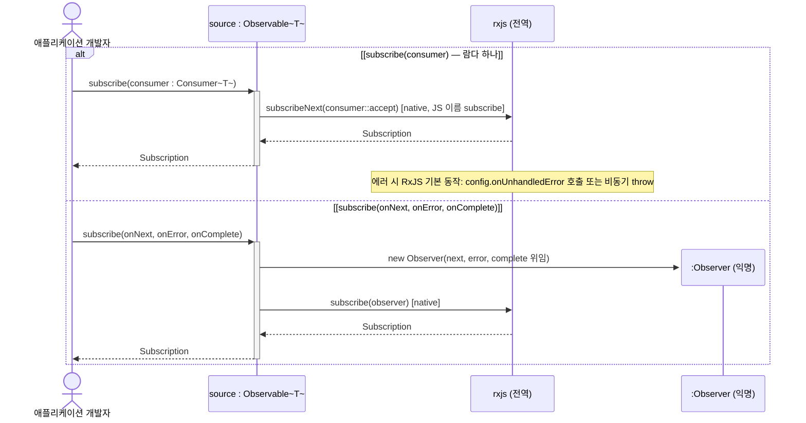
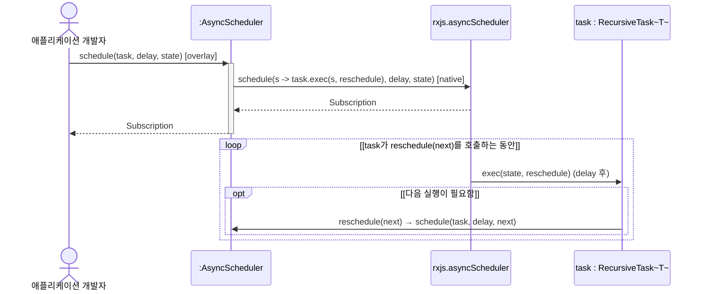
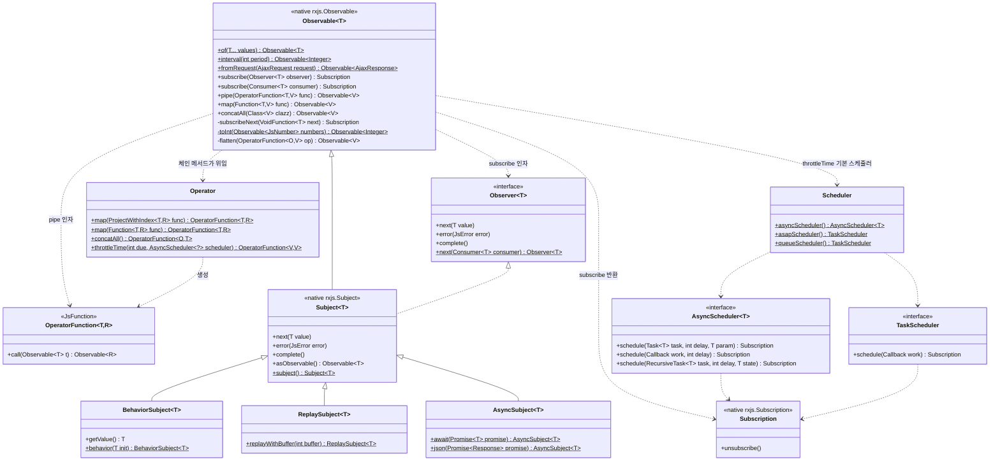

# 설계 모델

[SSD](ssd.md)의 시스템 연산 하나를 실현하는 객체 간 메시지를 **설계 시퀀스 다이어그램**으로 그리고, 거기 나온 연산을 **설계 클래스 다이어그램**으로 정리합니다. 모든 메시지는 실제 소스의 메서드입니다(`src/main/java/dev/sayaya/rx`).

## 설계 원칙 (모든 바인딩에 공통)

| 역할 | 구현 수단 | 예 |
|---|---|---|
| RxJS 함수·클래스 자체 | `@JsType(isNative = true)` 클래스의 `native` 메서드 + `@JsMethod(namespace="rxjs", name=...)` | `Operator.map(ProjectWithIndex)`, `Observable.of(T...)` |
| Java다운 시그니처(람다, `int`, `List`) | `@JsOverlay` 메서드: 네이티브 메서드로 위임하고 타입을 변환 | `Observable.interval(int)`, `Observable.toArray()` |
| 연산자 체이닝 | `Observable`의 `@JsOverlay` 메서드가 `pipe(Operator.x(...))`로 위임 | `map(func)`, `filter(predicate)`, `take(count)` |
| Java 람다 → JS 함수 | `@JsFunction` 인터페이스 | `ProjectWithIndex`, `UnaryFunction`, `Callback` |

이 방식은 GRASP의 **간접화(Indirection)**와 **보호된 변형(Protected Variations)**에 해당합니다. `Operator`가 RxJS 함수 시그니처의 변화를 흡수하고, `Observable` 체인 메서드는 사용자 API를 안정적으로 유지합니다. `@JsOverlay`는 호출 지점에 인라인되므로 래퍼 객체가 생기지 않습니다(NFR-02).

## 설계 시퀀스 다이어그램

### DS-01 `interval(period)` — JS number를 `Integer`로 (UC-01, NFR-03)

- `interval()`(인자 없음)은 `interval(0)`에 위임합니다. `range`, `timer`도 같은 `toInt` 경로를 씁니다.
- `toInt`의 `numbers.map(...)` 호출은 아래 DS-02의 `map(func)`와 같은 경로입니다.

### DS-02 체인 메서드 `map(func)` (UC-03)

`filter`, `take`, `skip`, `debounceTime`, `throttleTime` 등 체인 메서드는 모두 이 형태입니다. 3.0.0부터 시간 인자는 모두 `int`로 RxJS에 그대로 넘깁니다.

### DS-03 `concatAll(Class)` — 고차 Observable 평탄화 (UC-03)

`switchAll`, `mergeAll`, `exhaustAll`도 `flatten`을 공유합니다. `clazz`는 타입 추론용 토큰이며 런타임에 쓰이지 않습니다.

### DS-04 `subscribe(...)` — 에러가 사라지지 않게 (UC-04, FR-08)

**왜 JS 함수를 직접 넘기나:** 예전에는 람다 구독도 익명 `Observer`로 감쌌고, 그 `error()`가 비어 있어 에러가 조용히 사라졌습니다. 지금은 next 함수만 RxJS에 넘겨 RxJS가 "에러 콜백 없음"을 알고 처리되지 않은 에러로 보고합니다. `subscribe(onNext, onError)`는 빈 완료 콜백을 붙여 3인자 형태로 위임합니다.

### DS-05 `schedule(task, delay, state)` — 재귀 예약 (UC-06)

## 설계 클래스 다이어그램

대표 연산만 적었습니다. 전체 연산은 소스와 [추적성 표](../traceability.md)를 보세요. Mermaid는 `<<native>>` 같은 스테레오타입과 정적 멤버 밑줄을 정식 UML처럼 그리지 못합니다. 정적 멤버는 `$`로 표시했습니다.

이 클래스들은 모두 RxJS 객체를 가리키는 선언이라 Java 쪽 상태(필드)가 없습니다. 관계도 연관이 아니라 의존과 일반화뿐입니다. 예외로 `AjaxRequest`/`AjaxResponse`는 JS `Object`를 가리키는 필드 선언(`url`, `method`, `headers`, `status`, `response` 등)만 가집니다.

## 알려진 설계 부채

리팩토링 분석(2026-11)에서 찾은 항목과 처리 상태입니다. 3.0.0에서 호환성을 깨는 변경으로 해소한 항목의 사용자 영향은 [3.0 마이그레이션](../04-transition/migration-3.0.md)에 있습니다.

| 항목 | 위치 | 상태 |
|---|---|---|
| 숫자 파라미터 타입 혼재: `Operator.debounceTime/throttleTime`만 `JsNumber`, 나머지는 `int` | `Operator.java` | 3.0.0에서 해소: 모두 `int` |
| `throttleTime`의 `AsyncScheduler<V>`가 요소 타입에 묶임 | `Operator.java`, `Observable.java` | 3.0.0에서 해소: `AsyncScheduler<?>` |
| 런타임에 쓰이지 않는 `Class<T>` 타입 토큰 | `Subject`, `ReplaySubject`, `AsyncSubject`, `Scheduler` | 3.0.0에서 해소: `Class` 오버로드 제거, 무인자 제네릭 팩토리만 남김. `fromRequest`/`fetchJson`/`concatAll` 등의 `Class` 인자는 체인 중간에서 타입을 추론시키는 유일한 수단이라 유지 |
| 결합 결과 타입 혼재: `zip/toArray/pairwise`는 `List`, `combineLatest/withLatestFrom/forkJoin`은 `Object[]`, `bufferTime`은 `T[]` | `Observable.java` | 3.0.0에서 해소: 모두 `List` |
| 패키지 순환 의존 `rx`↔`scheduler`, `rx`↔`function` | [아키텍처](architecture.md#패키지-다이어그램) | 결정 AD-07로 수용(공개 시그니처가 만드는 순환이라 비파괴 해소 불가). 같은 GWT 모듈 안이라 빌드 문제는 없음 |
