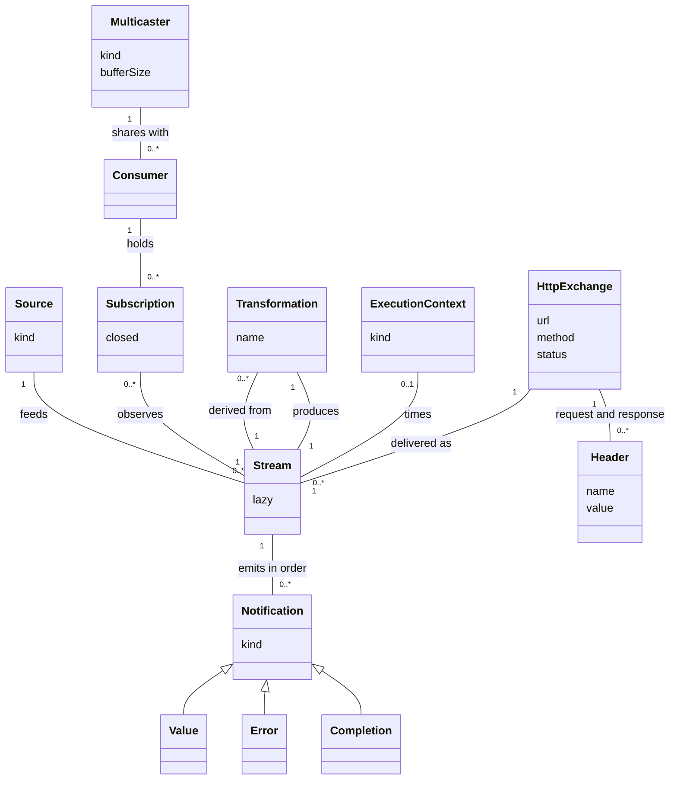

# 도메인 모델

반응형 스트림이라는 문제 영역의 **개념 클래스**입니다. 연산(메서드)과 구현 요소는 넣지 않았습니다. 설계 클래스는 [설계 모델](design-model.md)에 있습니다.

| 개념 | 뜻 |
|---|---|
| Stream | 구독될 때 시작되는 지연 실행 값의 흐름 (용어집의 Observable) |
| Notification | 스트림이 보내는 알림. 값(Value) 여러 개 뒤에 완료(Completion) 또는 에러(Error) 중 하나로 끝난다 |
| Source | 스트림의 근원: 고정 값, 범위, 컬렉션, Promise, 시간, DOM 이벤트, HTTP |
| Consumer | 알림을 받는 쪽 (용어집의 Observer) |
| Subscription | Consumer와 Stream의 연결. 끊으면 Stream이 자원을 정리한다 |
| Transformation | 한 스트림에서 새 스트림을 만드는 규칙 (용어집의 연산자) |
| Multicaster | 하나의 실행 결과를 여러 Consumer에게 나누는 것. 종류: 단순, 현재 값 유지, 최근 N개 재생, 마지막 값만 (용어집의 Subject) |
| ExecutionContext | 작업이 실행되는 시점(즉시 큐, 마이크로태스크, 타이머, 애니메이션 프레임) (용어집의 Scheduler) |
| HttpExchange | 요청과 응답 한 쌍 |
