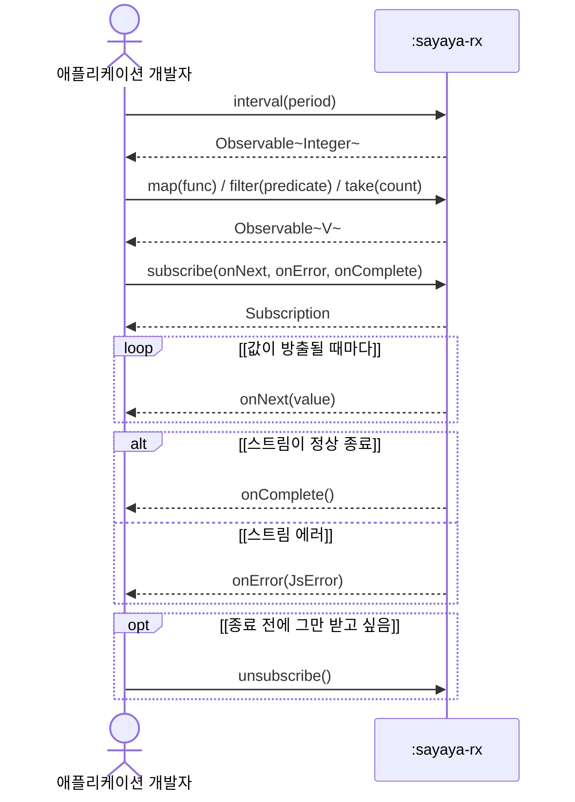
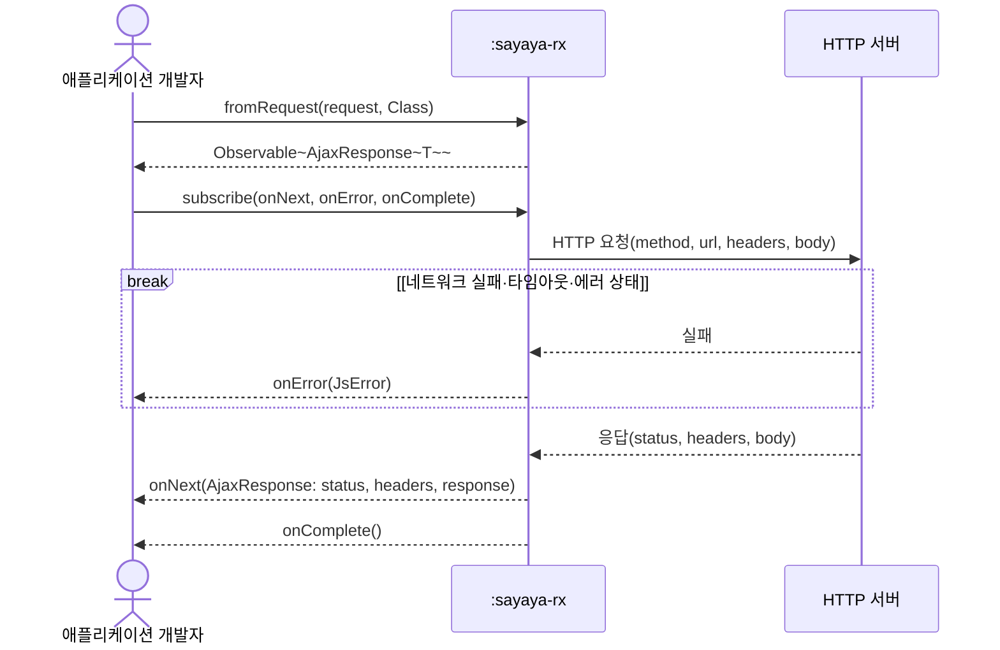
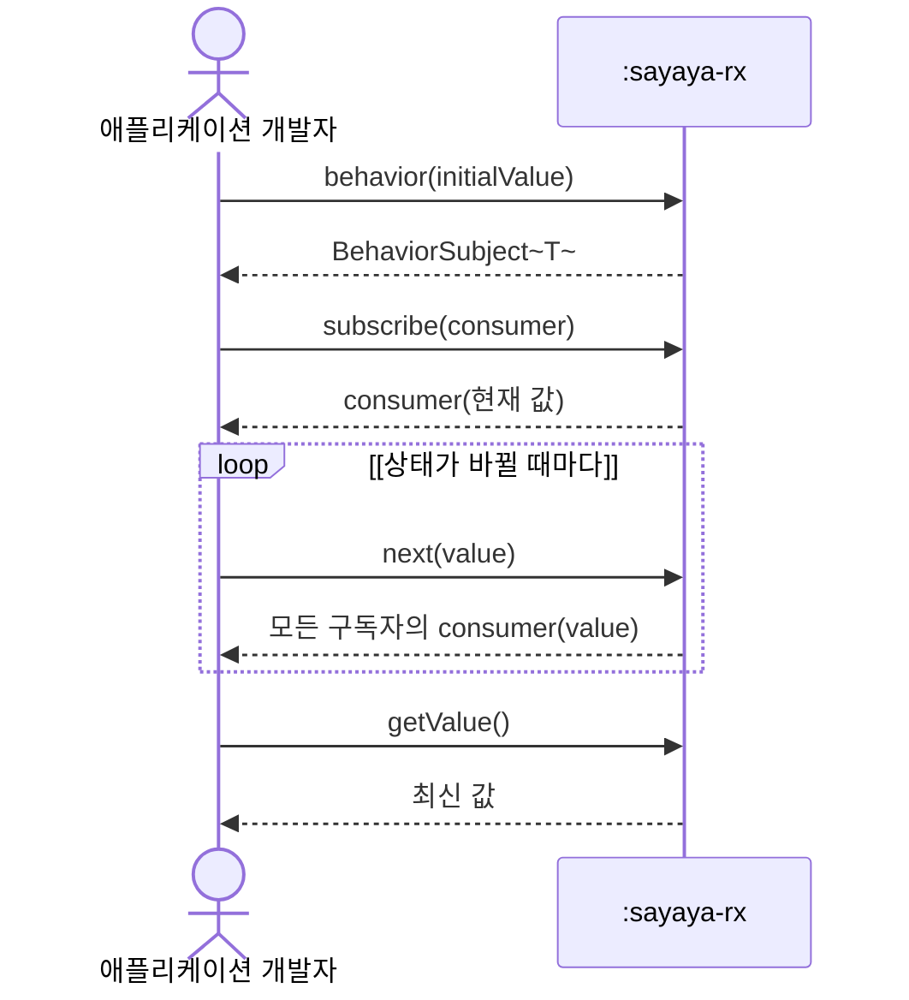
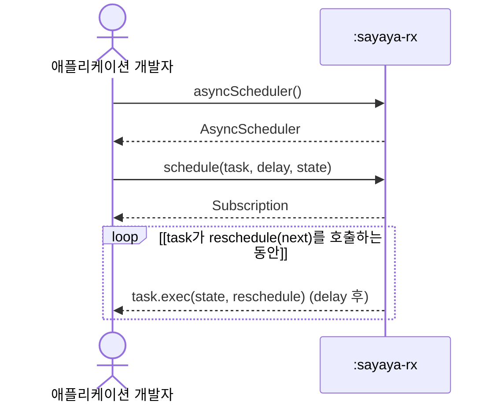

# 시스템 시퀀스 다이어그램 (SSD)

시스템(`:sayaya-rx`)을 블랙박스로 보고 액터가 보내는 **시스템 연산**만 그립니다. 이 라이브러리에서 시스템 연산은 곧 공개 API이므로, 이름을 실제 메서드 이름과 같게 둡니다. 설계에서 각 연산을 실현하는 방식은 [설계 모델](design-model.md)에 있습니다.

RxJS 런타임, 브라우저, HTTP 서버는 시스템 밖의 외부 시스템입니다.

## UC-04 구독하고 해제하기 (UC-01, UC-03 포함 시나리오)

**대안: 람다 하나로 구독** (`subscribe(Consumer)`): 에러가 나면 시스템이 개발자에게 직접 알리지 않고 RxJS의 처리되지 않은 에러 경로(`rxjs.config.onUnhandledError` 또는 비동기 throw)로 보고합니다(UC-04 확장 3a-2).

## UC-02 HTTP 응답을 스트림으로 받기

## UC-05 Subject로 상태 공유

## UC-06 작업 예약

## 시스템 연산 목록

전체 목록은 [추적성 표](../traceability.md)에 있습니다. 대표 연산은 다음과 같습니다.

| 유스케이스 | 시스템 연산 |
|---|---|
| UC-01 | `of`, `range`, `from`, `merge`, `concat`, `forkJoin`, `defer`, `empty`, `throwError`, `interval`, `timer`, `fromEvent`, `fromMouseEvent`, `fromKeyboardEvent` |
| UC-02 | `fromRequest`, `fetchJson` |
| UC-03 | `pipe`와 체인 메서드(`map`, `filter`, ...) |
| UC-04 | `subscribe(...)`, `unsubscribe()` |
| UC-05 | `subject`, `behavior`, `replay*`, `async`, `await`, `json`, `next`, `error`, `complete`, `getValue`, `asObservable` |
| UC-06 | `asyncScheduler`, `asapScheduler`, `queueScheduler`, `animationFrameScheduler`, `schedule` |
