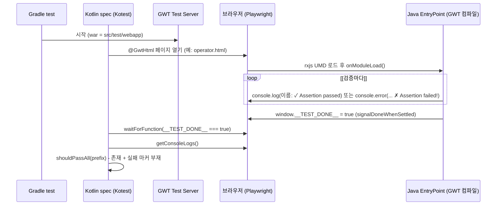

# 테스트 설계

바인딩 결함은 JS 런타임에서만 드러나므로, 모든 검증을 실제 브라우저(Playwright)에서 실행합니다(NFR-05).

## 구조: 2단계 검증



1. **Java EntryPoint**(`src/test/java/dev/sayaya/rx/*Test.java`): 라이브러리를 실제로 호출하고 `Helper.assertEquals`로 결과를 콘솔에 남깁니다. 비동기 결과는 `Helper.eventually(...)`로 20ms마다 확인하고, 모든 검사가 끝나면 `Helper.signalDoneWhenSettled(minMs)`가 완료 신호를 올립니다.
2. **Kotlin spec**(`src/test/kotlin/dev/sayaya/*Test.kt`, `GwtTestSpec`): 페이지를 열어 완료 신호를 기다린 뒤 콘솔 로그를 검사합니다. `shouldPassAll(prefix, expectedCount?)`(`LogAssertions.kt`)는 해당 접두사의 로그 줄이 **없으면 실패**하고, 있으면 모든 줄에 `Assertion failed!`가 없는지 확인합니다.

## 테스트 모듈

| 모듈 (`*.gwt.xml`) | EntryPoint | 페이지 | Kotlin spec | 테스트 케이스 수* |
|---|---|---|---|---|
| `dev.sayaya.ObservableGeneratorTest` | `ObservableGeneratorTest.java` | `observable_generator.html` | `ObservableGeneratorTest.kt` | 21 |
| `dev.sayaya.OperatorTest` | `OperatorTest.java` | `operator.html` | `OperatorTest.kt` | 101 |
| `dev.sayaya.SubjectTest` | `SubjectTest.java` | `subject.html` | `SubjectTest.kt` | 9 |
| `dev.sayaya.SchedulerTest` | `SchedulerTest.java` | `scheduler.html` | `SchedulerTest.kt` | 6 |

\* 2026-11 기준 `build/test-results/test/*.xml`의 `tests` 값.

- 테스트 모듈은 `build.gradle.kts`의 `gwt.devMode.modules`에 등록되어 있고, `gwtTestCompile`이 `src/test/webapp/<모듈 이름>/`에 컴파일 결과를 씁니다. 이 디렉터리는 생성물이므로 커밋하지 않습니다.
- 테스트 데이터: `src/test/webapp/users.json`, `rx-test-data.json`(ajax 테스트용).
- `@GwtHtml` 경로는 war 디렉터리(`src/test/webapp`) 기준 상대 경로입니다(gwt-test 2.3.0부터).

## 실행

```bash
./gradlew clean build          # 전체 빌드와 브라우저 테스트
./gradlew test --tests dev.sayaya.SubjectTest   # 한 spec만
./gradlew gwtDevMode           # 테스트 모듈을 devMode로 띄워 브라우저에서 직접 확인
```

결과는 `build/test-results/test/TEST-*.xml`의 `failures`/`errors`로 판정합니다. 업그레이드 전후 비교는 up-to-date 캐시를 피하도록 `clean`을 붙입니다.

## 작성 규칙

- 검증 이름은 Kotlin `shouldPassAll`의 접두사와 같게 둡니다(예: `"take()"`). 같은 접두사가 다른 이름의 앞부분이 되지 않게 주의합니다(`"timer"`는 `"timer(due)"`도 잡습니다).
- 고정 지연 뒤 한 번 확인하는 대신 `eventually`로 조건이 될 때까지 기다립니다. 결과가 완료로 확정되는 스트림(`take(n)` 등)에 씁니다.
- 새 검사를 추가한 뒤 접두사를 일부러 틀리게 바꿔 실패하는지 한 번 확인하면, 검사가 실제로 무언가를 보고 있는지 알 수 있습니다.

## 남은 개선점

- `OperatorTest.java`와 `SchedulerTest.java`에는 아직 고정 지연 assert가 남아 있습니다(zip, combineLatest, debounce, throttle, bufferTime, windowTime 등).
