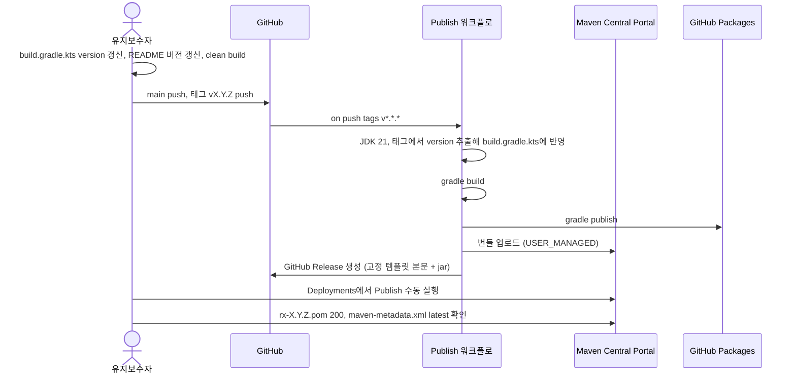

# 릴리스·배포 절차

UC-08(릴리스)의 상세 절차입니다. 워크플로는 `.github/workflows/publish.yml`입니다.

## 산출물과 배포 대상

| 대상 | 좌표 / 위치 | 비고 |
|---|---|---|
| Maven Central | `dev.sayaya:rx:<버전>` | `com.vanniktech.maven.publish`의 `publishToMavenCentral()`, GPG 서명 |
| GitHub Packages | `https://maven.pkg.github.com/sayaya1090/maven` | `publishing.repositories` |
| GitHub Release | 태그 `v<버전>` | `build/libs/*.jar`(본체, `-sources`, `-javadoc`) 첨부 |

## 주 성공 시나리오

1. `build.gradle.kts`의 `version`과 README의 설치 좌표·"현재 버전"을 갱신하고 `./gradlew clean build`로 확인합니다.
2. `main`을 push하고 `vX.Y.Z` 태그를 push합니다. `workflow_dispatch`로 `version` 입력을 주어 실행할 수도 있습니다.
3. 워크플로가 성공했는지 확인합니다(`gh run watch <run-id> --exit-status`).
4. **Maven Central은 자동 공개되지 않습니다.** 로그에 `Uploaded bundle to Central Portal as USER_MANAGED`가 남으면 central.sonatype.com → Deployments에서 해당 배포를 Publish해야 합니다.
5. 공개 확인: `https://repo1.maven.org/maven2/dev/sayaya/rx/X.Y.Z/rx-X.Y.Z.pom`이 200이고 `maven-metadata.xml`의 `<latest>`/`<release>`가 X.Y.Z인지 봅니다. GitHub Packages는 package versions API로 확인합니다.

**확장**
- 3a. 워크플로 실패: 원인을 고친 뒤 태그를 다시 만들기보다 패치 버전을 올리는 것을 우선합니다(이미 공개된 버전은 바꿀 수 없음).
- 4a. pom이 계속 404: Portal에서 배포 상태(검증 실패 여부)를 확인합니다.

## 자격증명

워크플로는 다음 secrets를 씁니다(값은 문서·로그에 남기지 않습니다): `_GITHUB_TOKEN`, `GPG_PRIVATE_KEY`, `GPG_PASSWORD`, `MAVEN_CENTRAL_USERNAME`, `MAVEN_CENTRAL_PASSWORD`. 로컬 빌드는 `GITHUB_USERNAME`/`GITHUB_TOKEN`(또는 `gradle.properties`의 `github_username`/`github_password`)이 있어야 GitHub Packages의 플러그인을 받을 수 있습니다.

## 주의

- GitHub Release 본문은 워크플로의 **고정 템플릿**입니다. 호환성을 깨는 API 변경이 있으면 Release 노트에 변경 목록을 직접 보강합니다.
- CI는 Gradle wrapper가 아니라 러너의 `gradle`을 씁니다. wrapper 파일은 현재 저장소에 커밋되어 있지 않습니다.
